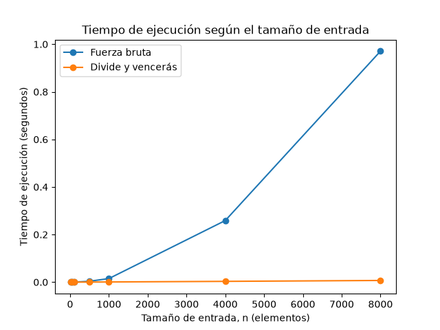

## Laboratorio evaluativo 02
**Nombre: Nathalie Gabriela Miranda Rejón**

### Instrucciones para reproducir el experimento
Para reproducir el experimento se debe ingresar a la carpeta lab2-divide-y-vencer y crear el entorno virtual para instalar las dependencias necesarias.

Primero se crea el entorno virtual con:
```bash
python -m venv venv
```
En Windows, utilizando Git Bash, se activa el entorno virtual con:
```bash
source venv/Scripts/activate
```
Con el entorno virtual activo, se instalan las dependencias del proyecto mediante:
```bash
pip install -r requirements.txt
```
Para verificar que las dependencias se instalaron correctamente se puede utilizar:
```bash
pip list
```
Para ejecutar las pruebas de los algoritmos se utiliza:
```bash
python pruebas.py
```
Este archivo comprueba que las dos soluciones obtengan la misma suma máxima en diferentes casos de prueba.

Para realizar las mediciones de tiempo y generar la gráfica:
```bash
python medicion.py
```
Este archivo mide los tiempos de ejecución de ambos algoritmos, calcula el promedio de las repeticiones y genera la gráfica comparativa en graficas/tiempo_vs_n.png.

La carpeta venv/ se encuentra incluida en .gitignore, por lo que el entorno virtual no se versiona en el repositorio. Si otra persona clona el proyecto, debe crear su propio entorno virtual e instalar las dependencias mediante requirements.txt.

### Parte 1 — Implementación y pruebas

**Código:** [`subarreglo.py`](subarreglo.py) 
            [`pruebas.py`](pruebas.py)

Se implementaron dos soluciones para encontrar el subarreglo de mayor suma: fuerza bruta y divide y vencerás. La primera prueba todas las combinaciones posibles de inicio y fin, mientras que la segunda divide el arreglo en dos mitades y compara las mejores soluciones de cada mitad con la solución que cruza el punto medio.

Para verificar su funcionamiento realicé las siguientes pruebas:

- Un arreglo con un solo elemento.
- Un arreglo con todos sus valores negativos.
- Un arreglo con todos sus valores positivos.
- El ejemplo proporcionado en el laboratorio.
- Un caso en el que la mejor suma cruza el punto medio.
- Veinte casos aleatorios para comparar los resultados de ambos algoritmos.

En las pruebas se comparó la suma máxima obtenida por las dos soluciones. Todas las pruebas pasaron correctamente.

### Parte 2 — Medición y gráfica

**Código:** [`medicion.py`](medicion.py) 

Se midió el tiempo de ejecución de ambos algoritmos con arreglos de tamaños 10, 50, 100, 500, 1000, 4000 y 8000 elementos. Los datos se generaron mediante números enteros aleatorios entre -100 y 100 utilizando una semilla fija para que los datos pudieran reproducirse.

Para cada tamaño se utilizó la misma lista en ambos algoritmos. El tiempo se midió con time.perf_counter(), tomando únicamente el tiempo de ejecución de cada algoritmo. Además, cada medición se repitió tres veces y se calculó el promedio para reducir el efecto de variaciones puntuales.



## Parte 3 — Análisis de resultados

### 1. Recurrencia

La recurrencia de subarreglo_maximo es `T(n)=2T(n/2)+Θ(n)`

El término `2T(n/2)` aparece porque dividimos el arreglo en dos mitades y buscamos el mejor subarreglo en cada una. El término `Θ(n)` corresponde a suma_cruzada, la cual recorre las dos mitades para encontrar la mejor suma que cruza el punto medio.

Aplicando el método maestro, `a=2, b=2` y `f(n)=Θ(n)`. Como `n^{log_b a} = n^{log_2 2}=n`, se cumple que `f(n)=Θ(n^(log_b a))`, por lo tanto podemos ver que corresponde al caso 2 del método maestro, con `k=0`, y obtenemos `T(n)=Θ(n log n)`.

Por otro lado, fuerza bruta prueba todos los posibles pares de inicio y fin. Hay `n(n+1)/2` intervalos y como la suma se actualiza en tiempo constante en cada paso, el número total de operaciones crece cuadráticamente y su complejidad es `Θ(n^2)`.

### 2. Lo medido contra lo esperado

En la gráfica podemos observar que fuerza bruta crece mucho más rápido que divide y vencerás. Para `n=8000` fuerza bruta tarda aproximadamente 0,972 segundos, mientras que divide y vencerás tarda 0,00676 segundos.

Al comparar `n=4000` y `n=8000`, fuerza bruta pasa de 0,26668 a 0,97172 segundos. El tiempo se multiplicó por `0,97172/0,26668 ≈ 3,64`, cerca del factor 4 esperado para `Θ(n^2)`.

Divide y vencerás pasa de 0,00338 a 0,00676 segundos, aproximadamente 2 veces. Para `Θ(n log n)`, la proporción teórica entre esos tamaños es cerca de 2,17. Los resultados son cercanos pero podemos ver que no son idénticos porque medimos tiempos reales que pueden variar por el equipo y los costos de ejecución.

### 3. Tamaños pequeños

En mis mediciones, para `n=10` divide y vencerás tarda más, aproximadamente 0,00000497 segundos frente a 0,00000330 de fuerza bruta, pero para `n=50` ya es más rápido, por ende podemos notar que el cambio ocurre entre los tamaños medidos de 10 y 50, pero no conocemos el punto exacto porque no probé los tamaños intermedios en este rango.

Esto la verdad pasa porque dividir también tiene un costo como las llamadas recursivas, ya que con entradas pequeñas ese costo puede reducir la ventaja del algoritmo.

### 4. ¿Cuándo conviene dividir?

Para hallar el máximo de un arreglo, podemos dividirlo en dos mitades, encontrar el máximo de cada una y comparar ambos resultados. La recurrencia sería `T(n)=2T(n/2)+Θ(1)`

Combinar cuesta tiempo constante porque solo comparamos dos máximos, mientra que por el método maestro la complejidad resultante es `Θ(n)`. Recorrer el arreglo una sola vez también cuesta `Θ(n)`, así que dividir no mejora el orden de complejidad. En este caso, recorrerlo una vez es más sencillo y evita el costo adicional de la recursión.

### 5. Concepto para la gerente

Recomiendo divide y vencerás para procesar la serie de la cooperativa. En la prueba con 8000 registros tardó aproximadamente 0,00676 segundos, frente a 0,972 segundos de fuerza bruta. Para una serie de un millón de registros, esa diferencia puede ser importante si el proceso debe repetirse con frecuencia o dentro de un tiempo limitado.

Como estimación, usando el tiempo medido para `n=8000` y el crecimiento cuadrático, fuerza bruta tardaría cerca de 4,22 horas, mientras que para divide y vencerás usando el crecimiento `n log n`, estimamos cerca de 1,30 segundos.  Estos tiempos no son mediciones directas ni garantías, sino extrapolaciones basadas en las complejidades y los resultados obtenidos.
