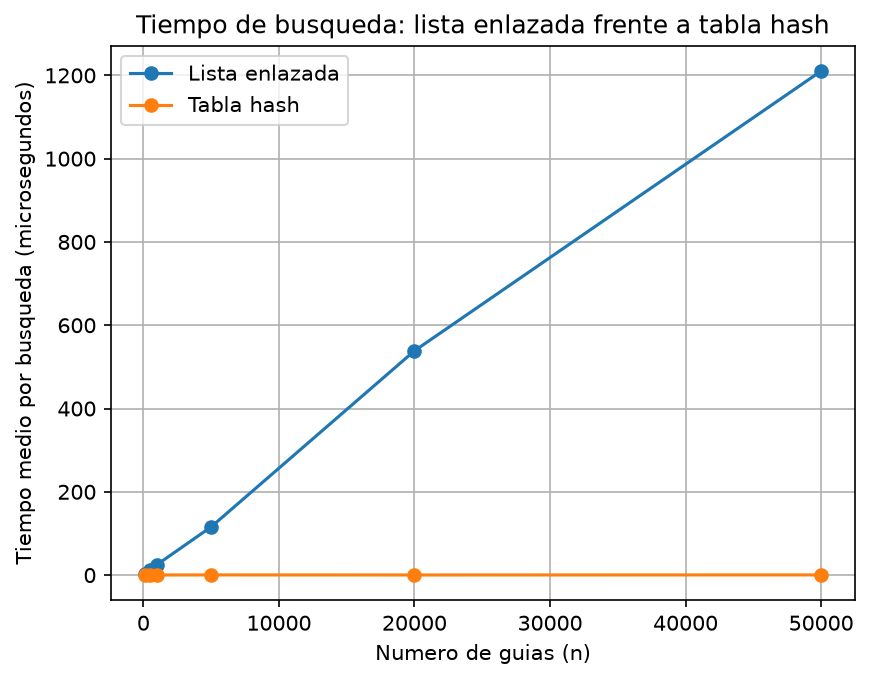
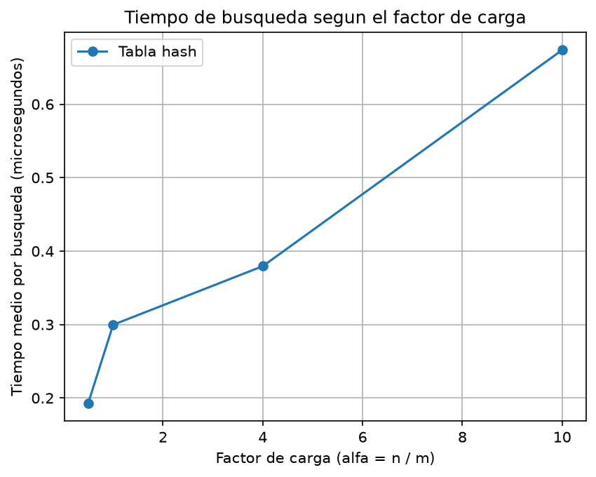

## Laboratorio evaluativo 03
**Nombre: Nathalie Gabriela Miranda Rejón**

## Instrucciones para reproducir el experimento
Para reproducir el experimento se debe ingresar a la carpeta lab3-estructuras-datos y crear el entorno virtual para instalar las dependencias necesarias.

Primero se crea el entorno virtual con:
```bash
python -m venv venv
```
En Windows, utilizando Git Bash, se activa el entorno virtual con:
```bash
source venv/Scripts/activate
```
Con el entorno virtual activo, se instalan las dependencias del proyecto mediante:
```bash
pip install -r requirements.txt
```
Para verificar que las dependencias se instalaron correctamente se puede utilizar:
```bash
pip list
```
Para ejecutar las pruebas de los algoritmos se utiliza:
```bash
python pruebas.py
```
Este archivo comprueba el funcionamiento de la lista enlazada y la tabla hash, incluyendo casos de colisión.

Para realizar las mediciones y generar las gráficas:
```bash
python medicion.py
```
Este archivo compara los tiempos de búsqueda, imprime las tablas de resultados y genera las gráficas graficas/lista_vs_tabla.png y graficas/tiempo_vs_alfa.png.

La carpeta venv/ debe estar incluida en .gitignore por lo que el entorno virtual no se versiona en el repositorio. Si otra persona clona el proyecto, debe crear su propio entorno virtual e instalar las dependencias mediante requirements.txt.

## Parte 1 - Implementar y verificar las dos estructuras

**Código:** [`estructuras.py`](estructuras.py) 
            [`pruebas.py`](pruebas.py)

Se implementaron una lista enlazada y una tabla hash con encadenamiento, utilizando clases propias para los nodos y las estructuras de datos. Las pruebas comprobaron su funcionamiento mediante búsquedas y casos de colisión.

Se verificó que las guías insertadas pudieran encontrarse y que las búsquedas de guías inexistentes devolvieran `None`. También se comprobó el manejo de colisiones con una tabla de tamaño `m = 7`: las guías `10`, `24` y `17` producen la misma posición (`3`), por lo que quedan almacenadas en una cadena de longitud `3`. En este caso, el factor de carga es `α = 3/7`.

Finalmente, se realizaron pruebas adicionales con datos para comparar el comportamiento de las estructuras y verificar que las colisiones se manejaran correctamente.

## Parte 2 - Medir y graficar

**Código:** [`medicion.py`](medicion.py) 

Se utilizó time.perf_counter() para medir los tiempos de búsqueda fallida. Cada medición se repitió tres veces y se calculó el promedio, utilizando 200 búsquedas por caso.

En el primer experimento se compararon la lista enlazada y la tabla hash para `n = 100, 500, 1.000, 5.000, 20.000 y 50.000` guías. Para cada tamaño se utilizó una tabla hash con `m = 47, 251, 499, 2.503, 10.007 y 24.989` casillas, manteniendo un factor de carga cercano a `2`.



En el segundo experimento se mantuvo constante `n = 20.000` y se modificó el tamaño de la tabla (`m = 40.009, 19.997, 4.999 y 1.999`) para estudiar el efecto de distintos factores de carga sobre el tiempo de búsqueda.



## Parte 3 - Análisis

### 1. Costo teórico

En una lista enlazada, para buscar una guía debemos recorrer los nodos uno por uno, comparándola con la almacenada en cada nodo. Si la guía existe, podemos encontrarla antes del final, pero si no existe debemos recorrer toda la lista para comprobarlo. Así, si duplicamos la cantidad de guías, aproximadamente duplicamos el trabajo; por eso buscar una guía inexistente cuesta `Θ(n)`.

En una tabla hash con encadenamiento, la función hash indica en qué casilla buscar y solo revisamos la lista asociada a ella. El costo promedio es `Θ(1 + α)`, donde `α = n/m` es el factor de carga: el número de guías dividido entre el número de casillas. El `1` representa acceder a la casilla y `α` el costo promedio de revisar los elementos que hay en ella. Por eso, si el factor de carga se mantiene constante, el tiempo no debería aumentar proporcionalmente al número de guías.

Esto depende del supuesto de dispersión uniforme simple: que la función hash reparta las guías de forma aproximadamente uniforme entre las casillas. Si todas cayeran en la misma casilla, para buscar una guía inexistente tendríamos que recorrerlas todas; la tabla perdería su ventaja y costaría `Θ(n)`, como la lista enlazada.

### 2. Lo medido contra lo esperado

En la primera gráfica al pasar de `20.000` a `50.000` guías el tamaño aumentó `2,5 veces`. El tiempo de la lista enlazada pasó de `538,6142 µs` a `1210,3810 µs` aumentando aproximadamente `2,25 veces`, siendo esto coherente con `Θ(n)` porque una búsqueda fallida debe recorrer todos los nodos. Ya en la tabla hash el tiempo pasó de `0,3000 µs` a 0`,4330 µs`, aumentando `1,44 veces`. Esta variación menor es compatible con `Θ(1)`, ya que el factor de carga se mantuvo aproximadamente constante.

**EXPERIMENTO A: LISTA FRENTE A TABLA HASH**

| n     | m     | alfa  | Lista (us) | Tabla (us) |
|------:|------:|------:|-----------:|-----------:|
| 100   | 47    | 2.128 | 2.4710     | 0.1512     |
| 500   | 251   | 1.992 | 11.4168    | 0.1517     |
| 1000  | 499   | 2.004 | 25.0127    | 0.2648     |
| 5000  | 2503  | 1.998 | 115.8480   | 0.4077     |
| 20000 | 10007 | 1.999 | 538.6142   | 0.3000     |
| 50000 | 24989 | 2.001 | 1210.3810  | 0.4330     |

Ya en la segunda gráfica al aumentar `α` de aproximadamente `1 a 10`, el tiempo pasó de `0,2997 µs` a `0,6740 µs`, aumentando unas `2,25 veces`. Esto concuerda con `Θ(1 + α)` ya que al haber más guías por casilla puede aumentar el número de comparaciones. Aunque es verdad que los tiempos presentan algunas variaciones la tendencia general es coherente con lo esperado.

**EXPERIMENTO B: EFECTO DEL FACTOR DE CARGA**

| n     | m     | alfa real | Tiempo (us) |
|------:|------:|----------:|------------:|
| 20000 | 40009 | 0.4999    | 0.1927      |
| 20000 | 19997 | 1.0002    | 0.2997      |
| 20000 | 4999  | 4.0008    | 0.3795      |
| 20000 | 1999  | 10.0050   | 0.6740      |

### 3. Colisiones

Una colisión ocurre cuando dos guías producen la misma posición en la tabla, esto puede ocurrir incluso si hay más casillas que guías, porque la función hash no garantiza que cada guía tenga una posición exclusiva. Por ejemplo, con `h(k) = k mod 7`, las guías `10, 24 y 17` llegan a la casilla `3`.

El encadenamiento guarda en cada casilla una lista de las guías que colisionan, siendo este muy sencillo y permitiendo almacenar varias guías en la misma casilla, pero eso sí, requiere memoria adicional para los nodos y recorrer la cadena cuando hay colisiones.

El direccionamiento abierto en cambio guarda todos los elementos dentro de la propia tabla y busca otra casilla disponible mediante una estrategia de exploración, evitando las listas adicionales, pero necesita espacio libre y pueden llegar a aumentar el costo de búsqueda cuando la tabla se llena.

### 4. Tabla hash o árbol de búsqueda

Una tabla hash no es adecuada para consultar las guías entre X y Y, porque no las mantiene ordenadas y normalmente habría que revisar todas sus entradas. En cambio, un árbol binario de búsqueda organiza las guías menores a la izquierda y las mayores a la derecha, facilitando las consultas por rango.

Sin embargo, su rendimiento depende del equilibrio. Si se insertan ordenadamente `400.000` guías en un árbol sin equilibrar, su altura sería de aproximadamente `399.999` aristas y las inserciones requerirían `n(n − 1)/2 = 79.999.800.000` comparaciones, convirtiéndolo en una estructura similar a una lista enlazada.

En un árbol equilibrado, la altura sería aproximadamente `log₂(n)`, unas `19` aristas para `400.000` guías. Su construcción tendría un costo del orden de `n log₂(n)`, aproximadamente `7,44` millones de operaciones como estimación. Por eso, recomiendo un árbol de búsqueda equilibrado para las consultas por rango.

### 5. Recomendación para la jefa de operaciones

Para Rutas del Caribe recomiendo una tabla hash con encadenamiento para consultar el estado de una guía específica y un árbol binario de búsqueda equilibrado para las consultas por rango. Mantener ambas estructuras requiere memoria adicional y actualizarlas cuando cambia un envío.

Para 5.000.000 de guías estimo que una búsqueda fallida en la lista enlazada tardaría aproximadamente 121 ms, esto se basa en que su costo teórico es `Θ(n)`, porque debemos recorrer todos los nodos cuando la guía no existe. Además al aumentar las guías de `20.000 a 50.000` (2,5 veces), el tiempo medido aumentó aproximadamente `2,25` veces, lo que respalda una tendencia cercana a la lineal. Por eso al pasar de `50.000 a 5.000.000` de guías se estima un tiempo cercano a `100` veces el medido.

En la tabla hash estimo un tiempo de `0,4 a 0,5 µs` tomando como referencia los `0,4330 µs` medidos con `50.000` guías. Esta estimación supone que se mantiene un factor de carga cercano a `2` y una distribución adecuada de las guías, condiciones bajo las cuales el costo esperado es `Θ(1 + α)`. Ambos tiempos son estimaciones, no mediciones directas con cinco millones de envíos.

